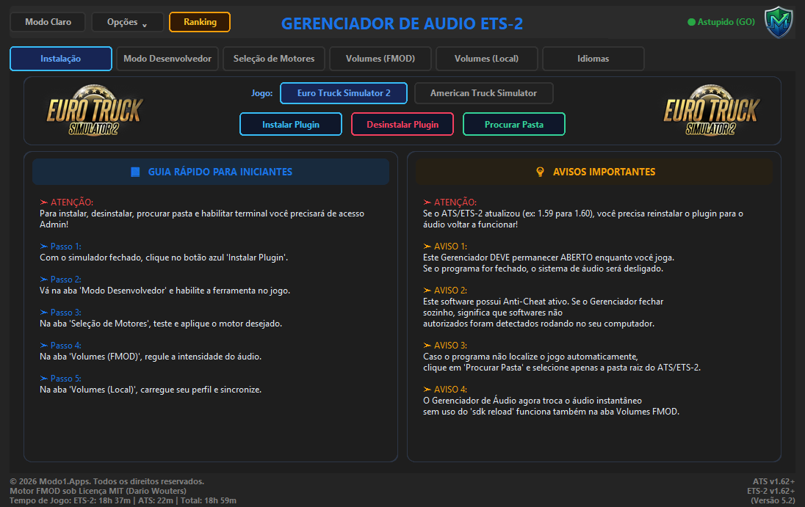
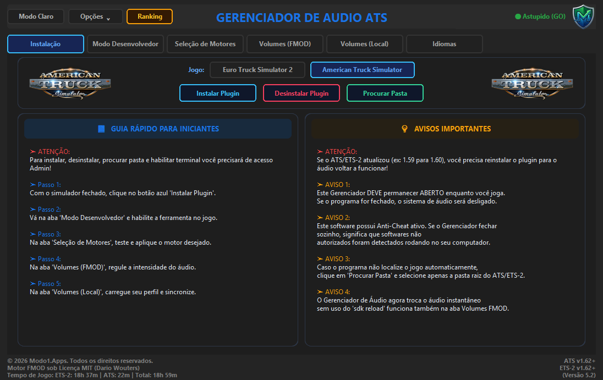
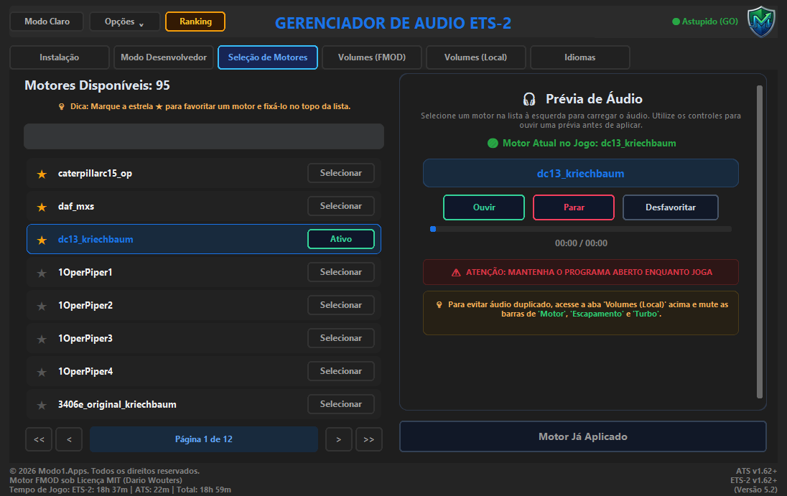
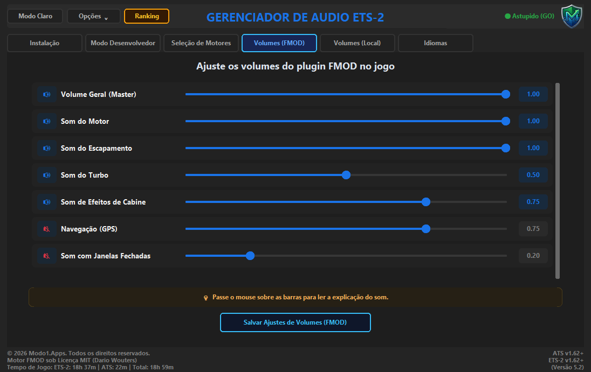
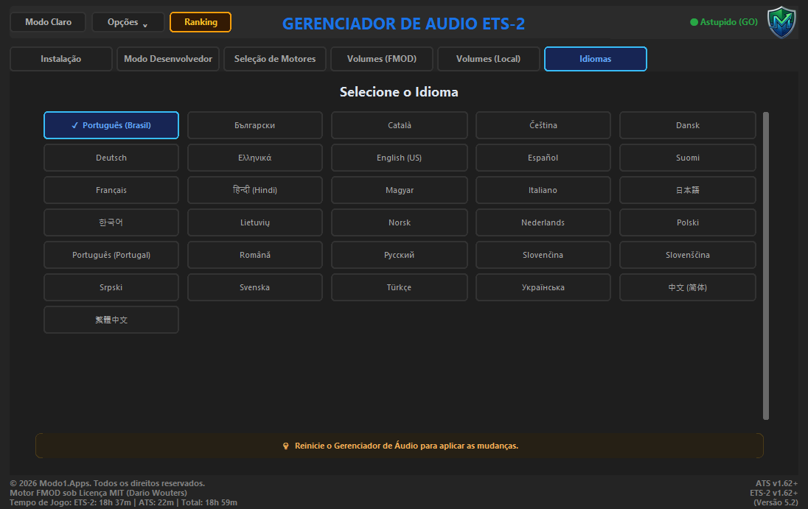

  <h1>🚚 Gerenciador de Áudio (ATS / ETS-2)</h1>
  
Uma ferramenta completa e global para gerenciar sons de motores e volumes FMOD no American Truck Simulator e Euro Truck Simulator 2.

  
<i>A complete, global tool to manage engine sounds and FMOD volumes in American Truck Simulator and Euro Truck Simulator 2.</i>

  
  
  
    

  <h2>⬇️ DOWNLOAD & INSTALADOR OFICIAL / DOWNLOAD & INSTALLER</h2>
  
  
<b>🇧🇷 Instruções de Instalação:</b> Clique no botão acima para baixar. Após baixar o pacote <b>Gerenciador_de_Audio.zip</b>, basta descompactar e executar o <b>Instalador Oficial Windows</b>. O assistente instalará o programa automaticamente no seu sistema, criará os atalhos na Área de Trabalho e Menu Iniciar, e cuidará de toda a configuração.

  
<b>🇺🇸 Installation Instructions:</b> Click the button above to download. After downloading <b>Gerenciador_de_Audio.zip</b>, simply unzip and run the <b>Official Windows Installer</b>. The setup wizard will automatically install the program on your system, create Desktop and Start Menu shortcuts, and handle all configurations.

   

  
  
  
  
  

 

  
    
  
    
  
    
  
    
  

 

## 🇧🇷 Sobre o Projeto (About in Portuguese)

O **Gerenciador de Áudio** é o software definitivo para os jogadores de **American Truck Simulator (ATS)** e **Euro Truck Simulator 2 (ETS-2)** que buscam realismo sonoro máximo. Com interface gráfica moderna, motor de alta performance e suporte nativo global, ele permite gerenciar sons de motores, instalar plugins FMOD e equalizar volumes com segurança e praticidade.

### ✨ Principais Recursos
- 🌐 **Globalização Total (31 Idiomas Steam):** Internacionalização completa com suporte nativo a 31 idiomas oficiais da plataforma Steam, incluindo seletor dinâmico com bandeiras e tradução instantânea de todas as telas.
- 📦 **Instalador Oficial Windows:** Novo instalador executável profissional com assistente moderno, criação automática de atalhos (Desktop / Menu Iniciar), desinstalador limpo no Painel de Controle e preservação total de configurações nas atualizações.
- 🚚 **Suporte a Múltiplos Jogos:** Funciona perfeitamente com American Truck Simulator e Euro Truck Simulator 2. A troca de jogos é feita em um único clique!
- 🎛️ **Controle Total de Áudio & FMOD:** Selecione sons gravados de motores reais, ouça prévias sonoras ao vivo no player embutido e ajuste volumes de motor, escapamento, freio motor e cabine sem mexer em arquivos de texto.
- ⚙️ **Instalação e Sincronização Automática:** Detecta automaticamente a pasta dos seus jogos na Steam e instala os plugins necessários de forma transparente.
- 🏆 **Hall da Fama Oficial:** Dispute posições e registre suas horas de simulação no ranking oficial online da comunidade Modo1.Apps.
- 🛡️ **Auditoria de Segurança VirusTotal:** 100% limpo (0/67 motores) pelas maiores autoridades mundiais de cibersegurança (Microsoft Defender, Kaspersky, BitDefender, CrowdStrike Falcon).
- ☁️ **Atualizações em Tempo Real pela Nuvem:** Validação segura de atualizações e novidades via Supabase Cloud sem necessidade de reconfiguração manual.

---

## 🇺🇸 About the Project (About in English)

The **Audio Manager** is the definitive software for **American Truck Simulator (ATS)** and **Euro Truck Simulator 2 (ETS-2)** players seeking the ultimate acoustic realism. Featuring a modern graphical interface, high-performance engine, and full global support, it allows you to effortlessly manage engine sounds, install FMOD plugins, and fine-tune volumes safely and quickly.

### ✨ Key Features
- 🌐 **Full Globalization (31 Steam Languages):** Complete internationalization with native support for 31 official Steam languages, dynamic flag selector, and real-time translation across all modules and devlogs.
- 📦 **Official Windows Installer:** Brand new professional setup wizard with automatic shortcut creation (Desktop / Start Menu), clean Control Panel uninstaller, and complete settings preservation across updates.
- 🚚 **Multi-Game Support:** Seamless 1-click switching between American Truck Simulator and Euro Truck Simulator 2.
- 🎛️ **Total Audio & FMOD Control:** Select sounds recorded from real engines, listen to live previews with the built-in player, and adjust engine, exhaust, turbo, Jake brake, and interior volumes without manual config editing.
- ⚙️ **Automatic Steam Detection:** Automatically identifies your Steam game installation directory and sets up the required audio plugins in seconds.
- 🏆 **Official Hall of Fame:** Compete on real-time community leaderboards and showcase your simulated driving hours.
- 🛡️ **Cybersecurity Audited (VirusTotal 0/67):** 100% clean across all major global security vendors (Microsoft Defender, Kaspersky, BitDefender, CrowdStrike Falcon).
- ☁️ **Cloud Synchronization:** Secure cloud updates and version checks powered by Supabase Cloud.

---

## 🤝 Créditos e Agradecimentos / Credits and Acknowledgments

Este projeto utiliza o incrível **Plugin FMOD para ETS-2/ATS**, criado por [dariowouters](https://github.com/dariowouters/ts-fmod-plugin?tab=readme-ov-file). 
O Gerenciador de Áudio atua como uma interface visual (GUI) avançada para facilitar a configuração e o uso do plugin desenvolvido por ele.

*This project utilizes the amazing **FMOD Plugin for ETS-2/ATS**, created by [dariowouters](https://github.com/dariowouters/ts-fmod-plugin?tab=readme-ov-file). 
The Audio Manager acts as an advanced graphical user interface (GUI) to make configuring and using his plugin much easier.*

**Plugin Repository:** [dariowouters/ts-fmod-plugin](https://github.com/dariowouters/ts-fmod-plugin/releases)
